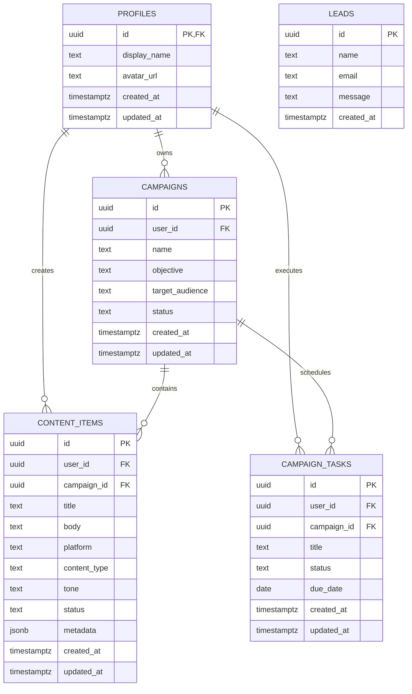

# CreatorFlow AI — Database & Schema Specification

## Relational Entity-Relationship Model

## Table Definitions & Constraints

### 1. `public.profiles`
- Primary Key: `id UUID REFERENCES auth.users(id) ON DELETE CASCADE`
- Automatically provisioned upon user signup via PostgreSQL trigger `on_auth_user_created`.

### 2. `public.campaigns`
- Primary Key: `id UUID DEFAULT gen_random_uuid()`
- Foreign Key: `user_id UUID REFERENCES auth.users(id) ON DELETE CASCADE`
- Status CHECK: `status IN ('planning', 'active', 'completed', 'paused')`
- Indexed on: `user_id`, `status`, `created_at DESC`

### 3. `public.content_items`
- Primary Key: `id UUID DEFAULT gen_random_uuid()`
- Foreign Keys: `user_id UUID REFERENCES auth.users(id) ON DELETE CASCADE`, `campaign_id UUID REFERENCES public.campaigns(id) ON DELETE SET NULL`
- Platform CHECK: `platform IN ('twitter', 'linkedin', 'instagram', 'youtube', 'blog')`
- Status CHECK: `status IN ('idea', 'draft', 'review', 'scheduled', 'published')`
- Indexed on: `user_id`, `campaign_id`, `platform`, `status`

### 4. `public.campaign_tasks`
- Primary Key: `id UUID DEFAULT gen_random_uuid()`
- Foreign Keys: `user_id UUID REFERENCES auth.users(id) ON DELETE CASCADE`, `campaign_id UUID REFERENCES public.campaigns(id) ON DELETE CASCADE`
- Status CHECK: `status IN ('pending', 'completed')`
- Indexed on: `user_id`, `campaign_id`, `status`, `due_date`

### 5. `public.leads`
- Primary Key: `id UUID DEFAULT gen_random_uuid()`
- Attributes: `name TEXT`, `email TEXT`, `message TEXT`, `created_at TIMESTAMPTZ`
- Public INSERT enabled with service-role read restriction.
