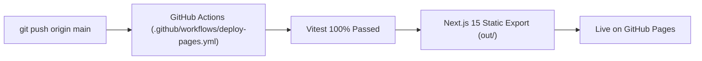

# CreatorFlow AI — Production Deployment Guide

This guide covers deployment options for **CreatorFlow AI**:
1. **GitHub Pages (Static Showcase & Automated CI/CD)** — Zero-cost hosting directly on GitHub.
2. **Vercel + Supabase (Full-Stack Edge Deployment)** — Production deployment with live server actions and database RLS.

---

## 🌐 Option 1: GitHub Pages Deployment (Automated via GitHub Actions)

### 1. Enable GitHub Pages in Repository Settings
When you visit your repository's Pages settings, you will see:
> *"GitHub Pages is currently disabled. Select a source below to enable GitHub Pages for this repository. Learn more about configuring the publishing source for your site."*

Follow these steps to activate it:
1. Open your repository on GitHub:  
   `https://github.com/maheswari9080/Datheon_Vibe_Coding_Mastery_-_Capstone_Project`
2. Click **Settings** (top navigation tab).
3. In the left sidebar under *Code and automation*, click **Pages**.
4. Under **Build and deployment** ➔ **Source**, click the dropdown and select:
   👉 **`GitHub Actions`**
5. That's it! GitHub Pages is now enabled.

### 2. How the Automated Pipeline Works
Our automated workflow [`.github/workflows/deploy-pages.yml`](./.github/workflows/deploy-pages.yml) runs on every push to `main`:
1. Checks out the repository and sets up Node.js 20.
2. Installs dependencies cleanly (`npm ci`).
3. Executes automated tests with Vitest (`npm test`).
4. Compiles a production-ready static export (`npm run build`) to the `./out` directory.
5. Injects the repository subpath:  
   `NEXT_PUBLIC_BASE_PATH: /Datheon_Vibe_Coding_Mastery_-_Capstone_Project`
6. Uploads the artifact and publishes directly to:  
   🔗 **`https://maheswari9080.github.io/Datheon_Vibe_Coding_Mastery_-_Capstone_Project/`**

### 3. Interactive Features on GitHub Pages
* **Interactive Prompt Sandbox**: Visitors can test platform-specific AI prompt synthesis directly in the browser.
* **AI Content Studio**: Features an intelligent client-side fallback engine that generates audience-calibrated copy and explainable AI fit scores without requiring a live server.
* **Kanban Pipeline & Campaigns**: Persistent local storage acts as a zero-key demo sandbox.
* **Theme Switching**: Dark/light mode persistence with zero flash of unstyled content.

---

## 🚀 Option 2: Full-Stack Vercel + Supabase Deployment

For production deployments with live OpenAI API keys and PostgreSQL Row-Level Security:

### 1. Database Provisioning (Supabase)
1. Log in to [Supabase](https://supabase.com) and create a new project.
2. Navigate to **SQL Editor**.
3. Run the migrations located in [`supabase/migrations/`](./supabase/migrations/):
   - `20261024000000_profiles_and_campaigns.sql`
   - `20261024000001_content_tasks_and_leads.sql`
   - `20261024000002_rls_security_policies.sql`
4. Copy the Project URL, Anon Key, and Service Role Key from **Project Settings ➔ API**.

### 2. Application Deployment (Vercel)
1. Import this repository into [Vercel](https://vercel.com).
2. Configure Environment Variables:
   - `NEXT_PUBLIC_SUPABASE_URL`: Your Supabase Project URL
   - `NEXT_PUBLIC_SUPABASE_ANON_KEY`: Your Supabase Anon Key
   - `SUPABASE_SERVICE_ROLE_KEY`: Your Supabase Service Role Key
   - `OPENAI_API_KEY`: (Optional) Your OpenAI Secret Key
   - `NEXT_PUBLIC_APP_URL`: Your production domain
3. Deploy! Next.js 15 automatically configures serverless edge functions and builds the project.

---

## ✅ Post-Deployment Verification Checklist
- [x] Public landing page loads with valid light/dark theme contrast.
- [x] Interactive sandbox presets populate calibrated copy.
- [x] Protected dashboard routes (`/dashboard`, `/dashboard/ai-studio`, `/dashboard/campaigns`, `/dashboard/content`) render smoothly.
- [x] AI Studio generates structured copy with Explainable AI reasoning.
- [x] Kanban status transitions move items across all 5 stages (`Idea` ➔ `Published`).
- [x] 100% automated test coverage passing with Vitest.
