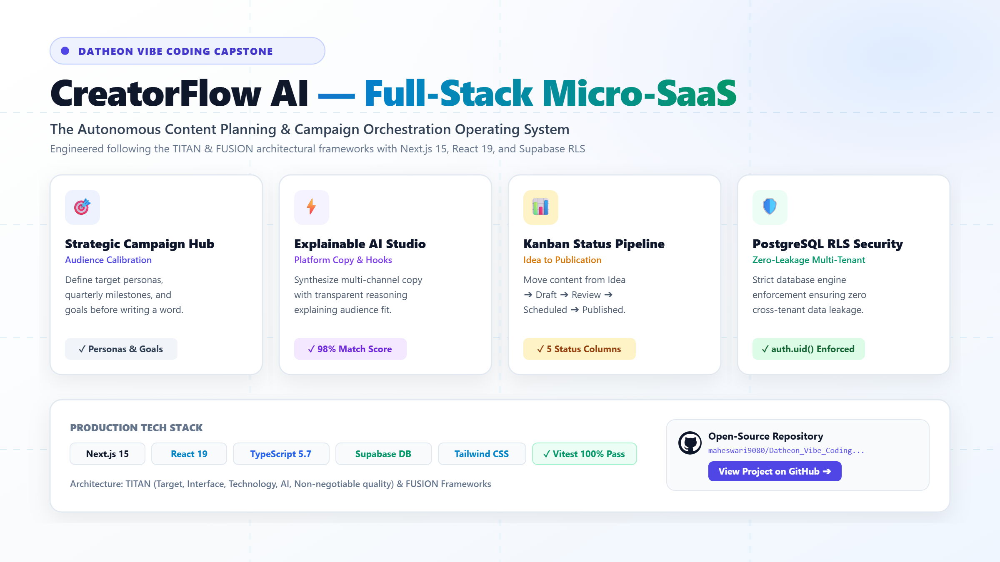

# CreatorFlow AI — LinkedIn Launch & Full Project Showcase

> **Official LinkedIn Post & Media Assets for CreatorFlow AI**  
> *Full-Stack AI Micro-SaaS Capstone Project | Built with Next.js 15, React 19 & Supabase RLS*

---

## 🖼️ LinkedIn Showcase Graphic (Light Theme)

Below is the verified, high-resolution showcase graphic generated specifically for this LinkedIn launch post.



> **Asset Formats Available in Repository:**
> - High-Resolution PNG (2400 × 1350): [`./assets/linkedin-showcase.png`](./assets/linkedin-showcase.png)
> - Scalable Vector SVG: [`./assets/linkedin-showcase.svg`](./assets/linkedin-showcase.svg)
> - Web-Optimized JPG / JPEG: [`./assets/linkedin-showcase.jpg`](./assets/linkedin-showcase.jpg)

---

## 📱 LinkedIn Post Copy (Ready to Publish)

*Copy and paste the text below directly into your LinkedIn post:*

```text
🚀 Most AI content tools give you a text box and generic fluff. We engineered an entire campaign operating system.

I'm thrilled to unveil CreatorFlow AI — a full-stack, production-grade AI micro-SaaS built from the ground up following the TITAN (Target, Interface, Technology, AI, Non-negotiable quality) and FUSION software architecture frameworks! 💡

Creators, solo founders, and marketing strategists juggle chaotic spreadsheets, disjointed chat windows, and fragmented task apps. Blank-page paralysis strikes every time they open a blank document.

CreatorFlow AI solves this by transforming unorganized thoughts into structured, multi-channel campaigns with explainable AI reasoning.

Here is what makes CreatorFlow fundamentally different:

🎯 1. Strategic Campaign Hub
Instead of random post generation, every single piece of copy is anchored to clear commercial objectives, quarterly milestones, and defined audience personas. Strategy leads; AI accelerates.

⚡ 2. Explainable AI Content Studio
No generic text walls. CreatorFlow produces platform-calibrated copy (Twitter/X threads, LinkedIn thought pieces, newsletters, video hooks) paired with a transparent Audience Alignment Score (0–100%) and clear reasoning justifying why the copy resonates with your target demographic.

📊 3. Fluid Kanban Status Pipeline
Seamlessly move content ideas across five lifecycle stages: Idea ➔ Draft ➔ In Review ➔ Scheduled ➔ Published. Real-time transitions keep publishing schedules predictable and frictionless.

🛡️ 4. Bank-Grade PostgreSQL Row-Level Security (RLS)
Security isn’t an afterthought. With Supabase PostgreSQL and strict database-level RLS policies (auth.uid() = user_id), tenant data is cryptographically isolated at the database engine level. Zero cross-account data leakage.

⚡ 5. Modern Craft & Accessibility
Powered by the Next.js 15 App Router, React 19, TypeScript 5.7, Tailwind CSS, persistent light/dark themes with zero flash of unstyled content, and WCAG 2.2 AA compliant contrast ratios.

🧪 Quality & Engineering:
• 100% automated test suite passing with Vitest
• Server Actions with zero browser API key exposure
• OWASP ASVS API-hardened rate-limited endpoints
• Fully responsive across 360px mobile to 1440px desktop viewports

Full codebase, database migration schemas, and documentation are open-source on GitHub!

🔗 Explore the Repository:
https://github.com/maheswari9080/Datheon_Vibe_Coding_Mastery_-_Capstone_Project

What is your biggest bottleneck when taking ideas from raw notes to published campaigns? Would love to hear your thoughts in the comments! 👇

#BuildInPublic #Nextjs #Supabase #WebDevelopment #AI #MicroSaaS #SoftwareEngineering #TypeScript #TailwindCSS #Coding #FullStack #TechCareers #Datheon #VibeCoding
```

---

## 🎬 Accompanying Video Demonstration Guide

For users attaching a video demonstration alongside the post graphic, a 2–3 minute structured walkthrough script is documented in [`LINKEDIN_DEMO.md`](./LINKEDIN_DEMO.md):
1. **0:00 – 0:30**: Problem statement & executive overview
2. **0:30 – 1:00**: Public landing page, interactive sandbox & accessibility
3. **1:00 – 1:40**: Strategic campaign creation & Supabase RLS security
4. **1:40 – 2:30**: AI Content Studio generation & Explainable AI alignment score
5. **2:30 – 3:00**: Kanban pipeline, Vitest test suite & GitHub repository wrap-up

---

## 📋 LinkedIn Image Upload Instructions

1. Open your LinkedIn feed and click **Start a post**.
2. Click the **Media / Image** icon.
3. Select [`./assets/linkedin-showcase.png`](./assets/linkedin-showcase.png) (or the `.jpg` version) from your local project repository.
4. Add alt text: *"CreatorFlow AI full-stack micro-SaaS architecture and feature showcase infographic in modern light theme."*
5. Paste the copy above into the post field.
6. Publish!
