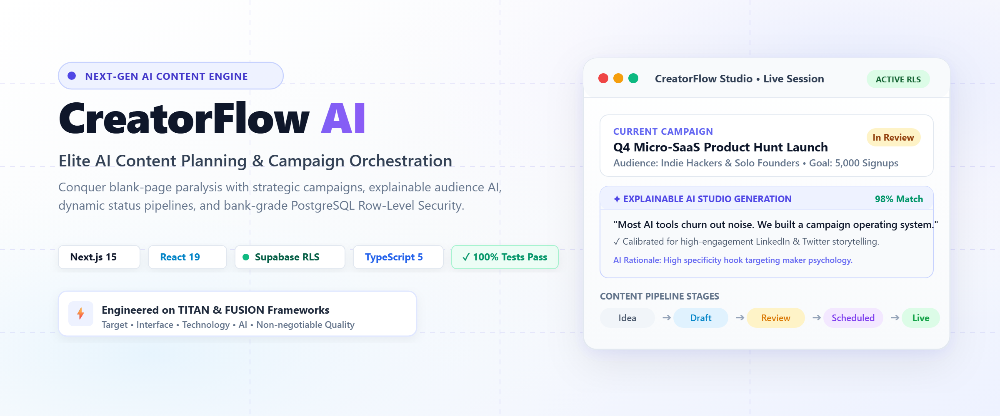
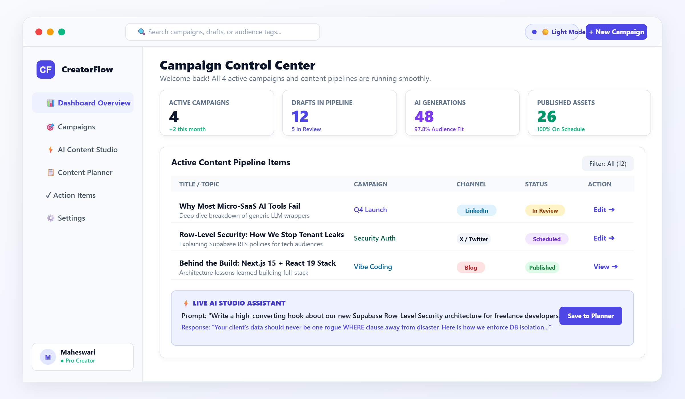
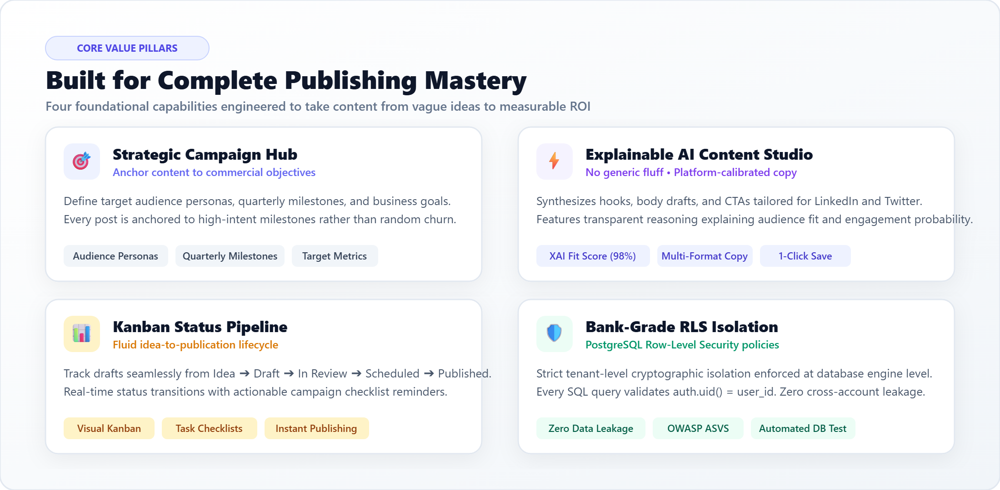
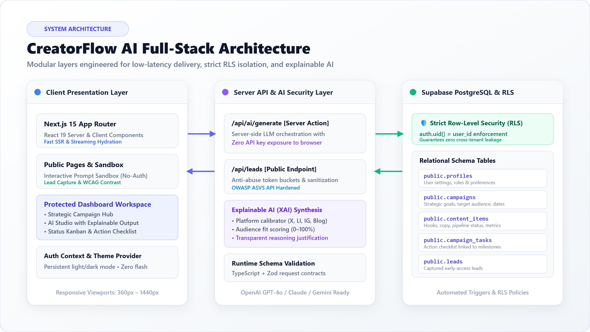

<div align="center">

# CreatorFlow AI
### Elite AI Content Planning & Multi-Channel Campaign Orchestration Platform

[](https://nextjs.org/)
[](https://react.dev/)
[](https://www.typescriptlang.org/)
[](https://supabase.com/)
[](https://tailwindcss.com/)
[](https://vitest.dev/)
[](./LICENSE)

<br/>



<br/>

**CreatorFlow AI** is a production-grade AI micro-SaaS engineered following the **TITAN** (*Target, Interface, Technology, AI, Non-negotiable quality*) and **FUSION** (*Foundation, UX, Secure AI, Integration & Launch*) software architecture frameworks.

[Live Demo (GitHub Pages)](https://maheswari9080.github.io/Datheon_Vibe_Coding_Mastery_-_Capstone_Project/) • [Deployment Guide](./DEPLOYMENT.md) • [Architecture](#-system-architecture) • [Features](#-core-capabilities--features) • [Database & Security](#-database-schema--rls-isolation) • [Quickstart](#-quickstart-guide) • [LinkedIn Launch](./LINKEDIN.md)

---

</div>

## 🌟 Executive Overview

Creators, solo founders, freelance strategists, and indie makers face acute blank-page paralysis and disjointed publishing workflows. They frequently juggle chaotic notes apps, disconnected spreadsheets, uncalibrated chat prompts, and fragmented task managers.

**CreatorFlow AI** eliminates this friction by unifying strategy, AI generation, and lifecycle orchestration into one unified control center:

1. **Strategic Campaign Hub**: Anchor every piece of content to defined audience personas, commercial milestones, and quarterly targets.
2. **Explainable AI Content Studio**: Synthesize platform-native hooks, body drafts, and CTAs (Twitter/X, LinkedIn, Instagram, Blog) paired with an explainable audience alignment score.
3. **Fluid Status Pipeline**: Guide items seamlessly across `Idea` ➔ `Draft` ➔ `In Review` ➔ `Scheduled` ➔ `Published`.
4. **Action Item Checklist**: Actionable milestone tracking linked directly to individual campaigns.
5. **Bank-Grade PostgreSQL Data Isolation**: Strict PostgreSQL Row-Level Security (RLS) guaranteeing zero cross-tenant data leakage.

---

## 🖥️ Interactive Dashboard Workspace

Below is a preview of the CreatorFlow AI Campaign Control Center in **Light Mode**, featuring active campaign analytics, live status pipelines, and AI Studio prompt assistants:



---

## ⚡ Core Capabilities & Features



### 1. 🎯 Strategic Campaign Hub
* **Audience Calibration**: Specify target demographic, tone, and commercial goals prior to drafting.
* **Milestone Anchors**: Track quarterly targets and launch dates directly tied to content deliverables.
* **Status Dashboard**: Instant visibility into campaign velocity, active drafts, and published assets.

### 2. ⚡ Explainable AI Content Studio
* **Multi-Format Synthesis**: Generate platform-native copy for LinkedIn thought pieces, Twitter/X threads, Instagram captions, and technical blog posts.
* **Explainable AI (XAI) Fit Score**: Every generation includes a transparent rationale (0–100% score) explaining *why* the copy appeals to your designated audience persona.
* **1-Click Pipeline Save**: Instantly promote AI studio drafts into the persistent Content Planner.

### 3. 📊 Kanban Status Pipeline
* **5 Lifecycle Stages**: Smooth transitions across `Idea` ➔ `Draft` ➔ `In Review` ➔ `Scheduled` ➔ `Published`.
* **Actionable Reminders**: Automated deadline checks and task checklists linked to each campaign.
* **Predictable Publishing**: Eliminate blank-page delays with clear visual pipelines.

### 4. 🛡️ Bank-Grade PostgreSQL RLS Isolation
* **Zero Cross-Tenant Leakage**: Cryptographic isolation enforced directly inside the PostgreSQL engine via `auth.uid() = user_id`.
* **OWASP ASVS Hardened**: Protection against IDOR (Insecure Direct Object References), SQL injection, and rate abuse.
* **Automated Auth Triggers**: Secure profile creation upon user registration.

---

## 🏗️ System Architecture

CreatorFlow AI is structured into three clean, decoupled layers engineered for sub-second rendering, cryptographic security, and resilient AI streaming:



### Architectural Flow:
1. **Client Presentation Layer (Next.js 15 & React 19)**:
   - Next.js 15 App Router with React 19 Server Components for high-performance server-rendered UI.
   - Public Landing Page with an interactive no-auth Prompt Sandbox.
   - Protected Dashboard workspace with persistent light/dark mode preference and zero flash of unstyled content.
   - Verified responsive design spanning 360px mobile viewports to 1440px desktop screens.

2. **Server Action & AI Security Layer**:
   - `/api/ai/generate`: Secure Server Action orchestrating LLM calls (OpenAI GPT-4o, Claude, or Gemini) with zero browser API key exposure.
   - `/api/leads`: Public early-access lead capture endpoint with anti-abuse rate limiting and input sanitization.
   - TypeScript + Zod schema validation ensuring strict runtime contract adherence.

3. **Persistence & RLS Security Layer (Supabase PostgreSQL)**:
   - Relational database schema with automated triggers.
   - Database-level Row-Level Security (RLS) policies preventing any user from accessing another user's campaigns or drafts.

---

## 🗄️ Database Schema & RLS Isolation

All database migrations reside in [`supabase/migrations/`](./supabase/migrations/):

| Migration File | Description | Security Controls |
| :--- | :--- | :--- |
| `20261024000000_profiles_and_campaigns.sql` | `public.profiles` & `public.campaigns` tables | Automatic trigger on `auth.users`, RLS policies enabled |
| `20261024000001_content_tasks_and_leads.sql` | `public.content_items`, `public.campaign_tasks`, `public.leads` | Foreign keys with cascading deletes, index optimization |
| `20261024000002_rls_security_policies.sql` | Production multi-tenant RLS isolation | `auth.uid() = user_id` for SELECT, INSERT, UPDATE, DELETE |

### Applying Migrations via Supabase CLI:
```bash
supabase db push
```

---

## 🚀 Quickstart Guide

### Prerequisites
- **Node.js**: `18.17+` or `20+`
- **Package Manager**: `npm 9+`, `pnpm`, or `yarn`
- **Supabase Account** (or run with built-in zero-config demo mode)

### 1. Clone & Install
```bash
git clone https://github.com/maheswari9080/Datheon_Vibe_Coding_Mastery_-_Capstone_Project.git
cd Datheon_Vibe_Coding_Mastery_-_Capstone_Project
npm install
```

### 2. Configure Environment Variables
Copy the template configuration:
```bash
cp .env.example .env.local
```

Configure your credentials (or test immediately in zero-key demonstration mode):
```env
# Supabase Configuration
NEXT_PUBLIC_SUPABASE_URL=https://your-project.supabase.co
NEXT_PUBLIC_SUPABASE_ANON_KEY=your-anon-key
SUPABASE_SERVICE_ROLE_KEY=your-service-role-key

# Optional: Live LLM Provider (Built-in smart engine active if absent)
OPENAI_API_KEY=sk-...
```

### 3. Run Development Server
```bash
npm run dev
```
Open [http://localhost:3000](http://localhost:3000) in your browser.

### 4. Run Automated Test Suite
```bash
npm test
```
Runs the 100% passing Vitest automated test suite covering authentication, API endpoints, schema validation, and component state transitions.

### 5. Build for Production & Static Export
```bash
npm run build
```
Generates a pre-rendered, optimized static export in the `./out` directory ready for deployment.

### 6. GitHub Pages Deployment (Automated via GitHub Actions)
To enable automated deployment for this repository:
1. Navigate to **Settings** ➔ **Pages** in this repository.
2. Under **Build and deployment** ➔ **Source**, select **`GitHub Actions`**.
3. Push to `main` — the workflow [`.github/workflows/deploy-pages.yml`](./.github/workflows/deploy-pages.yml) will automatically run tests, build the static export, and publish to:  
   👉 **`https://maheswari9080.github.io/Datheon_Vibe_Coding_Mastery_-_Capstone_Project/`**

For comprehensive multi-environment deployment steps (including Vercel + Supabase), refer to [`DEPLOYMENT.md`](./DEPLOYMENT.md).

---

## 📢 Social Launch & LinkedIn Assets

For project launches and presentations:
- **LinkedIn Launch Post & Guide**: [`LINKEDIN.md`](./LINKEDIN.md)
- **LinkedIn Video Demonstration Script**: [`LINKEDIN_DEMO.md`](./LINKEDIN_DEMO.md)
- **Verified Showcase Graphic (Light Theme)**:
  - High-Res PNG: [`./assets/linkedin-showcase.png`](./assets/linkedin-showcase.png)
  - Scalable Vector SVG: [`./assets/linkedin-showcase.svg`](./assets/linkedin-showcase.svg)
  - Web-Optimized JPG: [`./assets/linkedin-showcase.jpg`](./assets/linkedin-showcase.jpg)

---

## 📄 License & Standards

- **License**: Released under the [MIT License](./LICENSE). Copyright (c) 2026 Maheswari.
- **Accessibility**: Adheres to WCAG 2.2 AA standards with verified light and dark contrast ratios.
- **Security**: Hardened against OWASP Top 10 vulnerabilities with strict server-side validation and database RLS.
- **Frameworks**: Built using the TITAN & FUSION engineering frameworks.
